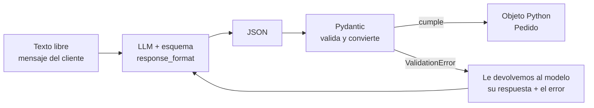

# Respuestas en JSON confiable con Pydantic


Código del **video 3** del minicurso gratuito **Agentes de IA con Python desde cero**, de [Datos Dinámicos](https://datosdinamicos.com).

Los LLM responden en texto, pero tu código necesita **datos**. Aquí convertimos mensajes de clientes escritos como sea ("pa ya ya ya", "el viernes", "una docena") en objetos de Python validados con Pydantic:

```text
$ uv run demo.py

Cliente           Producto                   Cant  Ciudad      Entrega     Urgente
Laura Gómez       3 cajas de café de Nariño     3  -           2026-11-17  sí
Carlos Ruiz       2 bultos de papa pastusa      2  -           2026-11-10  no
Diana             empanadas                    12  -           2026-11-11  sí
Jorge Pérez de Bogotá10 libras de queso campes    10  -           2026-11-20  no
Valentina         5 frascos de miel             5  Cali        2026-11-10  sí

5 pedidos guardados en pedidos.json
```

Esta es la salida real del video con `qwen2.5-coder:7b`, sin retoques. Los tipos son correctos, pero el modelo cometió errores de interpretación: la ciudad de Laura (Medellín) y la de Carlos (Pasto) no salieron, Jorge quedó con "de Bogotá" pegado al nombre y "el viernes" de Laura se convirtió en un martes. Pydantic garantiza la **forma** de los datos, no que el modelo haya entendido bien. Arreglar estos errores es parte de los [retos](#retos).

## La idea en un dibujo

> El esquema le dice al modelo **qué forma tener**; Pydantic verifica **que la tenga**. Necesitas los dos.



1. **El contrato.** Una clase de Pydantic (`Pedido`) dice qué campos existen, de qué tipo son y qué reglas cumplen (`cantidad > 0`).
2. **Antes de generar.** El esquema JSON de esa clase (`Pedido.model_json_schema()`) se le pasa al modelo con `response_format`. Las `description` de cada campo funcionan como instrucciones.
3. **Después de generar.** `Pedido.model_validate_json()` revisa que sea JSON, que los tipos sean correctos y que se cumplan las reglas. Si algo falla, lanza un `ValidationError` claro.
4. **Si falla, reintenta.** Le devolvemos al modelo su respuesta y el texto del error para que la corrija. Máximo 3 intentos.

## Antes de empezar

| Necesitas | Para qué |
|---|---|
| [Python 3.12+](https://www.python.org/downloads/) | Ejecutar los scripts |
| [uv](https://docs.astral.sh/uv/) (recomendado) o `pip` | Instalar las librerías |
| [Ollama](https://ollama.com) | Correr el modelo gratis en tu computador |
| Una API key de [OpenAI](https://platform.openai.com/api-keys) (opcional) | Solo si quieres usar un modelo en la nube |

¿Primera vez con Ollama o con el SDK de OpenAI? Empieza por los videos 1 y 2 del curso ([abajo](#minicurso-agentes-de-ia-con-python-desde-cero)).

## Cómo ejecutarlo

1. **Clona el repositorio**
   ```bash
   git clone https://github.com/AndresInsuasty/json-confiable-pydantic.git
   cd json-confiable-pydantic
   ```

2. **Descarga el modelo local** (unos 4,7 GB)
   ```bash
   ollama pull qwen2.5-coder:7b
   ```
   ¿Tu computador es más modesto? Usa `llama3.2:3b` (unos 2 GB) y cámbialo en el `.env` con `MODELO=llama3.2:3b`. Va a fallar más seguido, y eso también sirve para ver el reintento en acción.

3. **Crea tu archivo `.env`** a partir de la plantilla
   ```bash
   cp .env.example .env
   ```
   Para usar OpenAI, pon `PROVEEDOR=openai` y tu `OPENAI_API_KEY`. Si solo usas Ollama, déjalo como está.

4. **Ejecuta los pasos en orden**
   ```bash
   uv run paso1_json_a_mano.py
   uv run paso2_pydantic.py
   uv run paso3_esquema.py
   uv run extractor.py
   uv run demo.py
   ```
   uv instala las librerías la primera vez. Si prefieres pip:
   ```bash
   pip install -r requirements.txt
   python demo.py
   ```

## Los archivos, en el orden del video

| Archivo | Qué muestra |
|---|---|
| [`llm.py`](llm.py) | Cliente compartido: el mismo SDK de OpenAI sirve para Ollama (local) y para OpenAI (nube). |
| [`paso1_json_a_mano.py`](paso1_json_a_mano.py) | Pedir "responde en JSON" y ver por qué no es confiable: texto extra, ```` ```json ```` alrededor, claves que cambian entre ejecuciones. |
| [`modelos.py`](modelos.py) | El contrato: la clase `Pedido` con sus 6 campos, tipos, reglas y descripciones. |
| [`paso2_pydantic.py`](paso2_pydantic.py) | Pydantic sin LLM: `"3"` se convierte en `3`, `"tres"` lanza `ValidationError`, y `model_json_schema()` genera el esquema. |
| [`paso3_esquema.py`](paso3_esquema.py) | Obligar al modelo a seguir el esquema con `response_format`, `temperature=0` y la fecha de hoy en el prompt. |
| [`extractor.py`](extractor.py) | Versión final: la función `extraer_pedido()` con reintento cuando la validación falla. |
| [`demo.py`](demo.py) | Procesa los 5 mensajes de [`data/mensajes.txt`](data/mensajes.txt), imprime la tabla y guarda `pedidos.json`. |

## Tres detalles que hacen la diferencia

- **`temperature=0`**: le pides al modelo que elija siempre la opción más probable. Para extraer datos no quieres creatividad, quieres la misma respuesta cada vez. En la API de OpenAI la temperatura va de 0 a 2.
- **La fecha de hoy en el prompt**: sin ella, "el viernes" o "mañana" no se pueden convertir en una fecha. Por eso el prompt del sistema dice `Hoy es {date.today()}`.
- **`model_dump(mode="json")`**: convierte el objeto en un diccionario listo para `json.dumps`. Las fechas `date` se vuelven texto `"2026-11-17"`.

## Errores comunes

| Lo que ves | Causa | Qué hacer |
|---|---|---|
| `No es JSON válido: Expecting value: line 1 column 1` (paso 1) | El modelo envolvió el JSON en ```` ```json ```` o le agregó texto | Es justo lo que muestra el paso 1. Usa `response_format` con el esquema (paso 3) |
| `ValidationError` con `cantidad` en 0 | Un modelo pequeño no entendió "una docena" | El reintento de `extractor.py` le devuelve el error al modelo. Si pasa mucho, usa un modelo más grande |
| `Intento 1 falló, reintentando con el error...` | La validación falló y el modelo está corrigiendo | Es normal: así funciona el reintento |
| `ValueError: No se pudo extraer un pedido válido en 3 intentos` | El modelo falló 3 veces seguidas | `demo.py` salta ese mensaje. Prueba otro modelo o mejora las `description` de `modelos.py` |
| `APIConnectionError` | Ollama no está corriendo | Abre la app de Ollama o ejecuta `ollama serve` |
| `NotFoundError` (404) | El modelo está mal escrito o no lo has descargado | Revisa con `ollama list` y descárgalo con `ollama pull qwen2.5-coder:7b` |

> [!WARNING]
> Nunca subas tu archivo `.env` a GitHub: ahí está tu clave de OpenAI. Este repositorio ya lo incluye en el `.gitignore`.

## Retos

Ordenados de menos a más difícil. Cada uno refuerza una idea del video.

1. **Arregla la ciudad.** En la demo, Medellín y Pasto se quedaron en `-`. Mejora la `description` del campo `ciudad` en `modelos.py` (por ejemplo: *"Ciudad de entrega o ciudad desde donde escribe el cliente"*) y vuelve a correr `demo.py`. ¿Cuántas ciudades detecta ahora?
2. **Arregla "el viernes".** Laura pidió para el viernes y salió `2026-11-17`, un martes. Agrega al prompt del sistema el día de la semana (`date.today().strftime('%A')`) y comprueba si ahora calcula bien la fecha.
3. **Separa el nombre de la ciudad.** Jorge quedó como `"Jorge Pérez de Bogotá"`. Ajusta la descripción de `cliente` para que solo guarde el nombre de la persona.
4. **Agrega la unidad.** Crea un campo `unidad: Literal["caja", "bulto", "libra", "frasco", "unidad"]`. Un `Literal` obliga al modelo a escoger solo entre esas opciones.
5. **Valida fechas del pasado.** Con un `@field_validator` de Pydantic, rechaza un pedido cuya `fecha_entrega` sea anterior a hoy y observa cómo el reintento le pide al modelo que la corrija.
6. **Varios productos en un mensaje.** Escribe "quiero 2 cajas de café y 1 frasco de miel" y crea un modelo anidado: `productos: list[Item]`, donde `Item` tiene `nombre` y `cantidad`.
7. **Compara modelos.** Corre la demo con `llama3.2:3b` y con `qwen2.5-coder:7b` y cuenta cuántos reintentos necesita cada uno. Si tienes clave, prueba también con `PROVEEDOR=openai`.
8. **Guárdalo en una base de datos.** Cambia `pedidos.json` por una tabla de SQLite con el módulo `sqlite3` de Python. Gracias a Pydantic, los tipos ya llegan limpios.
9. **Bonus.** Explora el método `chat.completions.parse` del SDK de OpenAI, que recibe directamente tu clase de Pydantic y te devuelve el objeto ya validado.

Cuéntanos en los comentarios del video qué datos te gustaría sacar de tus propios mensajes.

## Siguientes pasos

En el próximo video le damos **funciones de Python** al modelo con **tool calling**. Por dentro usa exactamente esta misma idea: un esquema que describe qué argumentos espera cada función.

## Minicurso Agentes de IA con Python desde cero

1. [Qué es un agente de IA, en 30 líneas de Python](https://github.com/AndresInsuasty/agente-ia-30-lineas-python)
2. [Tu primer LLM desde Python: API de OpenAI o gratis con Ollama](https://github.com/AndresInsuasty/tu-primer-llm-desde-python)
3. **Respuestas en JSON confiable con Pydantic** (este repositorio)
4. Próximamente: tool calling, dale funciones de Python a tu modelo
